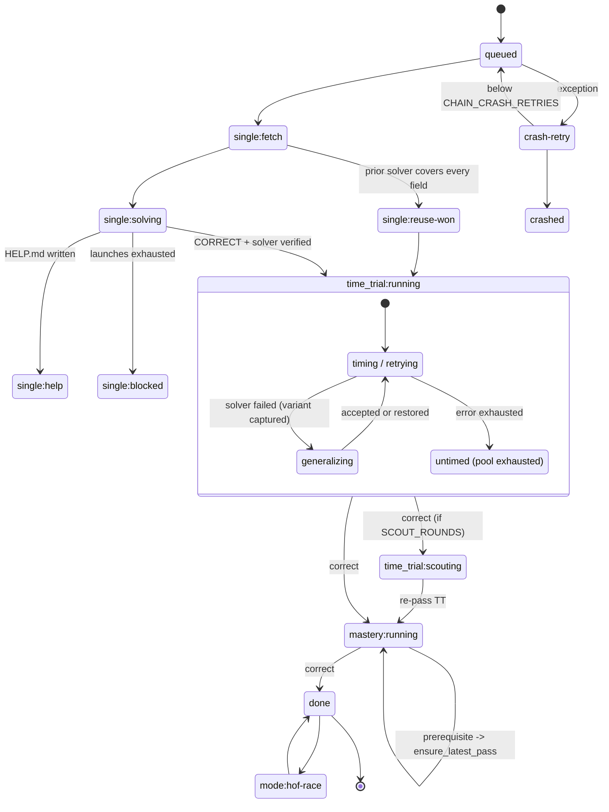
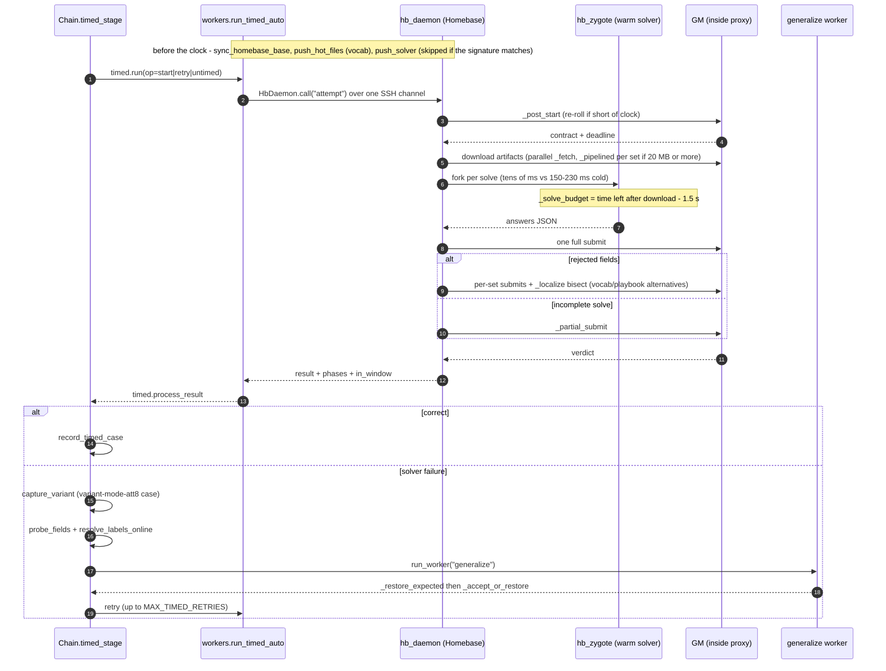

# hctf architecture: Huntress CTF 2026 "AI Arena" harness

A short tour of the harness for teammates who want to understand it and suggest improvements. The diagrams are Mermaid
and render inline on GitHub, and in VS Code's Markdown preview with the
"Markdown Preview Mermaid Support" extension (`bierner.markdown-mermaid`). For operations see `reference/RUNBOOK.md`. For the speed history see
`reference/SPEED.md`.

## 1. What this is

- **The game.** Every day the organizers release 5 lanes: warmups, metadata-forensics, script-analysis,
  binary-reverse-engineering and mobile-android. A web lane is prepared but hasn't been released yet. Each lane comes
  in 3 modes. **single_solve** is untimed. **time_trial** is one fresh variant on a clock (about 30-80 s today; it was
  about 6 s early on). **mastery** is a multi-set variant on a longer clock (80-200 s today). Everything goes through
  the **Game Master (GM)** HTTP API with a pairing token. The GM never reveals expected values. It only validates
  submissions, and synthetic labels must be spelled exactly.
- **Homebase** is an organizer-provided VM (inside the CTF VPN) with a low-latency "inside" GM proxy. It has a budget of
  60 credits/day, which VM time and Bedrock AI share.
- **North star.** A deterministic, general-purpose solver that runs on autopilot. In practice that means three things.
  The work is **LLM-first with standard tools** (readelf, Ghidra, jadx, exiftool and so on; we don't hand-build lane
  parsers). Every challenge leaves behind a **reusable solver plus regression cases**. Only **GM-confirmed knowledge**
  is ratcheted forward into `lib/` (the "determinism ratchet").

## 2. System overview

```mermaid
flowchart LR
  subgraph OPS["Operator"]
    PRE["bin/preflight.sh<br/>(warm-up checks)"]
    DAY["bin/day.sh N --wait"]
    CLI["hctf CLI<br/>dash / why / cost / reconcile"]
  end

  subgraph ORC["Orchestrator: hctf/orchestrate.py"]
    RUN["run()<br/>wait_for_release + Governor + Pools"]
    CHAIN["Chain(base).run<br/>one per challenge, in parallel"]
  end

  subgraph SINGLE["Single-solve machinery"]
    TRI["hctf/triage.py + hctf/toolchain.py<br/>(no LLM)"]
    REUSE["_reuse_race<br/>(lane solver + newest 3 prior solvers;<br/>partial banking, max 7 probes)"]
    INBOX["hctf/inbox.py<br/>(PostToolUse hook: HARNESS UPDATE)"]
    WW["WarmWorker: claude -p<br/>inside bwrap sandbox"]
    READY["_watch_ready<br/>early handoff + snapshot"]
  end

  subgraph ROB["Robustness"]
    PROBES["mutation / compound / family probes<br/>+ today-probe (warmups) + merge probe"]
    CASES["solver/cases<br/>(regression cases)"]
    GEN["transactional generalize<br/>(_accept_or_restore)"]
  end

  subgraph TIMED["Timed path"]
    AUTO["workers.run_timed_auto"]
    HBD["Homebase: hctf/hb_daemon.py<br/>+ hb_zygote.py (fork per solve)"]
    LOCAL["local fallback:<br/>hctf/hb_timed.py"]
  end

  subgraph KNOW["Knowledge layer: lib/"]
    PB["lib/playbook.py<br/>(NAMING_LAWS)"]
    KN["lib/knowledge.py"]
    VOC["lib/vocab.json"]
    ATT["lib/refs/attack.py"]
    COD["lib/codec.py + lib/decode.py<br/>+ lib/warmups_codecs.py"]
    META["lib/meta (+ prebuilt, speculative)"]
    BIN["lib/binary.hcfg_scan"]
    TECH["reference/techniques/"]
  end

  subgraph POST["Post-run"]
    HOF["hof_race"]
    RAT["ratchet (LLM, test-gated)"]
    SH["speed_harden"]
    COV["lib.refs.coverage + toolchain report"]
    PBLD["hctf prebuild<br/>(off-peak LLM breadth, gated)"]
  end

  GM[("Game Master API")]

  PRE --> DAY --> RUN --> CHAIN
  CLI -. reads .-> CHAIN
  CHAIN --> TRI --> REUSE --> WW --> READY
  REUSE -- "race note" --> INBOX -. "next tool call" .-> WW
  READY --> CASES
  READY --> PROBES --> CASES
  CHAIN --> AUTO
  AUTO -- "Homebase-first" --> HBD
  AUTO -- "exec_error / no HB" --> LOCAL
  AUTO -- "solver failure" --> GEN --> CASES
  HBD -- "inside proxy" --> GM
  LOCAL -- "public endpoint" --> GM
  WW -- "hctf submit --from-solver" --> GM
  KNOW -. "prompts + in-window labels" .-> WW
  KNOW -. "vocab push" .-> HBD
  CHAIN --> HOF --> RAT --> SH
  RAT -- "merges NOTES proposals" --> KNOW
  SH --> PBLD -- "speculative extractors / codecs / HCFG encodings" --> KNOW
  DAY --> COV
```

**Flow in one paragraph.** `bin/day.sh` (pre-flight is done at warm-up, never after the drop) launches
`hctf run --day N --local 5 --wait-release`. `run()` polls the GM every `RELEASE_POLL` (0.3 s) and groups challenges by
`paths.base_id`. It then runs one `Chain` per group in a thread pool. Each chain runs single, then time_trial, then
(optionally) scouting, then mastery. When every chain is finished, the run does `hof_race`, powers off Homebase if we
started it, then runs `ratchet(day)` and `speed_harden(day)`.

### Components

| Area | Where | Notes |
|---|---|---|
| Entry | `bin/env.sh`, `bin/preflight.sh`, `bin/day.sh`, `bin/hctf` -> `hctf/cli.py` | Pre-flight checks token expiry, GM reachability, the VPN route, a duplicate Windows OpenVPN client (`--fix`), bwrap, live Claude auth, lane tools and Homebase SSH/credits. |
| Orchestrator | `hctf/orchestrate.py` | `run`, `Chain`, `Governor` (credit gate), `Pools` (local=5 semaphore + Homebase). `chain.json` is written atomically by `set_state`. |
| Workers | `hctf/workers.py`, `hctf/prompts/{single,generalize,fix,ratchet}.md` | `_worker_cmd` builds `claude -p ... --effort high --output-format stream-json --strict-mcp-config --settings <json> --tools Bash,Read,Write,Edit,Skill,Task`. |
| Timed | `hctf/timed.py`, `hctf/hb_timed.py`, `hctf/hb_daemon.py`, `hctf/hb_zygote.py`, `hctf/remote.py` | Homebase-first, with a local fallback. A single persistent SSH channel (ControlMaster, `ControlPersist=600`, key `secrets/huntress_homebase`). |
| GM client | `hctf/gm.py` (stdlib only, keep-alive pool), `hctf/remote.py` `gm()` | `start`/`submit` try `_gm_via_daemon`, then `_gm_submit_hb`, then the public GM. |
| Labels | `hctf/labels.py`, `hctf/grouptest.py` (parallel group-test bisect), `hctf/hb_timed.py` `_localize` | Candidates come from sibling confirmed labels, artifact terms and `playbook.seed_candidates`. They're probed one at a time and recorded to `lib/vocab.json`. |
| Probes | `hctf/mutate.py`, `hctf/compound.py`, `hctf/family.py` | These write the `mutation-*`, `compound-dKK-*` and `family-*` regression cases. |
| Solvers/cases | `hctf/solvers.py` (`add_case`, `reuse_plan`, `test_solver`) | Cases live in `solver/cases/<name>/{artifacts/,contract.json,expected.json}`. |
| Rehearsal | `hctf/replay_gm.py`, `bin/fair_run.sh` | A local fake GM replays a solved day. A rehearsal copy copy runs "fair" rehearsals. |

## 3. Chain state machine

The stage strings are what `hctf dash` shows (`chain.json` -> `stage`). `<mode>` is `time_trial` or `mastery`.

There are also timed sub-states: `:rate-limited` and `:start-refused` (backoff), `:waiting-credits` (Governor),
`:fixing` (urgent in-clock fix worker), `:untimed-pass` and `:exhausted`, plus `:blocked` once `MAX_TIMED_RETRIES` (5)
is used up.

## 4. One timed attempt

If `run_timed_auto` raises an exec error, or `_homebase_ready()` is false (`_health_loop` probes every 5 s), it falls
back to `run_timed`. That runs `hctf/hb_timed.py` as a local subprocess against the public GM. The phases are the same,
but each GM call is slower.

## 5. Key approaches

- **Reuse race on singles.** `_reuse_race` runs `solvers.reuse_plan` over the newest 3 same-lane prior solvers. It
  submits only if the merged answers cover every field, then bisects with at most `REUSE_RACE_PROBES` (3) submits. A win
  goes straight to `single:reuse-won`, with a verified `_race_snapshot`.
- **Bank everything the race knows (Day 14 prep).** The race now always includes the cumulative metadata lane solver
  (`challenges/_lane/metadata-forensics`, backed by `lib/meta`). A complete merged set is submitted first; if it is
  rejected or incomplete, the confident subset is banked, then the speculative remainder (pure-halving bisect), then
  other solvers' values / spelling alternates for isolated wrong fields (`HCTF_RACE_PARTIAL`, <= 7 submits, yields when
  the worker submits). Implausible values (non-word slugs via `lib/slug.py`, local format failures) are dropped first.
  What the race proved reaches the worker in its go text or, if later, through `hctf/inbox.py` + the PostToolUse hook.
- **Spelling alternates.** `hctf/fmtalt.py`: after a single-field rejection on the untimed single, <= 3 same-value
  renderings (hex width/`0x`/case, GUID braces/case/bytes_le) are probed before the LLM spends a turn on it.
- **Warmups today-probe.** `hctf/today_probe.py` infers today's codec from the single (`lib/warmups_codecs.infer`, ~1000
  candidate encoders) and rehearses Mastery with it spliced into yesterday's verified Mastery case; misses trigger a
  generalize BEFORE the Mastery attempt. Only GM-verified cases can make a generalize green (`HCTF_VERIFIED_GREEN`).
- **LLM-authored breadth, ahead of time.** `hctf prebuild` runs off-peak workers (after the ratchet) that pre-write
  speculative metadata extractors, warmups codecs and HCFG storage encodings for likely-next concepts, each gated by
  independent-oracle fixtures + the full lane regression. Prebuilt answers only ever RACE beside the LLM worker.
- **The warm worker starts at chain start.** `WarmWorker` launches `claude -p` immediately and replies READY. It gets
  "GO" plus the triage once `timed.ensure_started` (GM start + artifacts), `_tool_prefetch` and the status prefetch have
  finished.
- **Stop at CORRECT, plus early handoff.** `_watch_ready` polls every `SPEC_POLL` (0.25 s). It pre-pushes the solver to
  Homebase (`_prepush_verified`) and takes a verified `_spec_snapshot`. Then it kills the worker (`STOPPED_RC`) and
  restores the verified files. The `.claude/hooks/stop_gate.py` Stop hook stops a worker from quitting before CORRECT
  plus a verified solver (or `HELP.md`). `nudge.py` points long runs at the `explore-alternatives` skill.
- **Homebase-first timed routing.** A persistent daemon handles every attempt, and a zygote keeps one warm process per
  solver dir (`runpy`, `run_name="hctf_warm"`) and forks for each solve. Pre-push and a deferred pull keep transfers off
  the clock.
- **Probes before the clock.** After the single passes, background probes start. `_start_mutation_pre` covers
  renamed/reordered/subset/unknown-field/mastery-shape mutations. `_start_compound_pre` replays earlier days' cases for
  the lane. `_start_family_pre` covers script codec families. Hard failures become cases, so the solver gets
  generalized before Time Trial (`_late_probes`, `_mastery_speed_gate`).
- **Transactional generalize.** The steps are a baseline `test_solver`, then `_snapshot_solver`, then the worker, then
  `_restore_expected` (**workers can never author `expected.json`**), then `_accept_or_restore`. If any previously
  passing case breaks, the worker's version goes to `.generalize-rejected/` and the snapshot comes back. `_watch_green`
  ends the worker early once everything is green. `_harvest_variants` banks up to 3 fresh variants as cases.
- **Label probing -> `vocab.json`.** `hctf labels` ranks the candidates and probes them one at a time.
  `hb_timed._vocab`/`_localize` read the confirmed spellings inside the window. `hctf submit` adds guards (per-field
  wrong caps, an ATT&CK `validate_answers` check) and logs `confirmed.json` and `submissions.jsonl`.
- **The post-day ratchet.** An LLM worker (`ratchet.md`) is the only writer to `lib/`. It merges each solver's
  `NOTES.md` "Proposed lib additions" into knowledge, playbook and codec. `lib/` is snapshotted first and restored if
  `ratchet_gate` tests fail.
- **Isolation.** Every worker runs under bwrap (`sandboxed`, `sandbox_hidden_paths`), with other account trees,
  transcripts and `/mnt/c` masked by tmpfs and tool symlink targets re-exposed read-only. Prompt rules alone weren't
  enough (see section 6).
- **Effort floor `high` on every lane.** `WORKER_EFFORT=high` and `LANE_EFFORT={}`. We tried xhigh and reverted it: each
  turn took about 50% longer with no gain. Turn caps (`MAX_TURNS`) are single 80, generalize 50, fix 30 and ratchet 80.
  Timeouts are `SINGLE_TIMEOUT` 25 min, `GENERALIZE_TIMEOUT` 12 min and `RATCHET_TIMEOUT` 15 min.
- **Self-healing workers.** `worker_outcome` classifies each exit. Limit and transient failures are relaunched up to
  `API_RELAUNCHES` (3) times, with 20/60/180 s backoff. An auth failure sets `AUTH_RC` and puts the chain into `help`.
  `record_metrics` writes `.run/metrics.tsv`, which `hctf cost` reads.
- **Triage without an LLM.** `hctf/triage.py` writes `<mode>/triage.md`: status, artifacts, extracted content and
  toolchain cues. For the script lane it adds `lib.codec.find_codecs`, the `hctf/js_sandbox.js` node vm sandbox and
  chepy magic. `hctf/toolchain.py` detects the toolchain (`TOOLCHAINS`, `TEXT_HINTS`, `CUES`) and installs missing tools
  in the background from `setup/tools/`. Gaps are logged so `hctf tool-gaps` can review them.

### The solver contract (what every worker delivers)

`solver/solve.py --contract <json> --artifacts <dir>` prints `{answer_id: value}` as JSON on its last line, with `None`
for an unknown field. It must handle Mastery sets and finish all sets in under 1 s. It may use only stdlib, `lib.*` and
pip libraries, because it runs on Homebase. `solver/NOTES.md` holds `## Technique`, `VARIANT AXIS:` lines and
`## Proposed lib additions`, which feed the ratchet.

## 6. Challenges and how we addressed them

| Challenge | What happened | Fix |
|---|---|---|
| GM synthetic-label spelling | Day 3 lost about 1.5 h guessing synonyms. | `hctf/labels.py` ranks and probes candidates into `lib/vocab.json`. `playbook.NAMING_LAWS` encodes the label grammar. There's an ATT&CK pre-submit guard. |
| Tight clocks, slow public-GM submits | A public submit took 5-8 s per call. | Homebase-first via the inside proxy (about 0.55 s per submit), a warm zygote fork per solve, pre-push, pipelined Mastery sets and capped start timeouts. Untimed/practice fallback once a variant pool is exhausted. |
| Time spent after CORRECT | The Day 6 review found 60% of worker time was spent after the answer was already CORRECT. | The stop-gate hook, plus the `_watch_ready` early-handoff snapshot. |
| Mastery compounding | Organizer signal: Mastery mixes earlier days' concepts. It first fired live on Day 13 warmups, where each line mixed the previous day's transform with a new one. | The compound probe/check and `mastery_delta` in the prompt. Auto-generalize fixed the live case in about 2 min. |
| Variant robustness | The organizers promised unseen mutations. | Mutation probes, in-window partial submit, variant harvesting and the codec-family probe. |
| VPN flaps | The tunnel dropped every ~4 min because a Windows OpenVPN client was using the same profile. | The VPN is now CLI-only, as a systemd service. Pre-flight detects the duplicate client, and `--fix` kills it. |
| cross-copy leak | A rehearsal worker ran `find /` and copied the other copy's solver. | Every worker runs under bwrap with the other trees and transcripts masked. |
| Claude Code Bash edit-diff stall | Snapshotting the multi-GB repo cost 10-25 s per write-ish Bash call. | Disabled via env and `bashEditDiffEnabled: false` in `worker_settings`. Re-check after CLI updates. |
| Homebase credits | VM time and Bedrock share 60/day. Bedrock shadows burned one account's credits in about 30 min. | Shadow workers (`hctf/hbshadow.py`) are opt-in (`HCTF_HB_SHADOW=0` by default). Homebase is used for the timed path only. |
| Replays burn real variant pools | | At most 2 replays per day on the main account. |
| Credential expiry | The GM token and the Claude CLI login both expire 2026-11-01, before the last day. | Pre-flight warns about both. |

## 7. Results so far (main account, real runs, wall clock from release)

| Day | Result | Wall clock | Note |
|---|---|---|---|
| D5 | (pre-15/15 era) | ~8:25 | One script single took 6.5 min. |
| D6 | 15/15 | 12:13 | VPN flaps, and xhigh effort was in use (reverted). |
| D7 | 15/15 | 6:16 | Replays got down to 2:07. |
| D8 | 15/15 | 20:22 | Three timed-path failures, all fixed the same day. |
| D9 | 15/15 | 1:59 | |
| D10 | 15/15 | 1:37 | |
| D11 | 15/15 | 1:09 | |
| D12 | 15/15 | 7:12 | The warmups Mastery decoder stalled; the untimed fallback rescued it. |
| D13 | 15/15 | 3:38 | 14/15 by 1:34. Warmups Mastery compounding was auto-fixed. |

**Day 14 prep validation (rehearsal copy, fair Day 13 with pre-D13 knowledge, all timed attempts local):** 15/15, every
mode first try, T+1:31 (main's real D13 was 3:38). The race dropped the gibberish slug, the today-probe identified the
new codec and generalized before Mastery (45 s), and Mastery passed first try. (Caveat: the rehearsal copy received the same
variants as main, so the metadata/warmups singles were not fully blind.)

Worker LLM cost per day has fallen from about $18-43 (D1-2) to about $2.5 (D13). The fastest public teams finish a whole
day in about 1:45. We report N/15 first, and an incomplete run never counts as "best".

## 8. Open problems: where we want help

1. **Layered compounding.** The warmups today-probe now rehearses today's codec inside yesterday's Mastery, and a merge
   probe covers metadata/binary/script, but several earlier concepts layered inside ONE artifact are still not
   synthesized; a new KEYED cipher (unknown key) defeats both the candidate library and the probe.
   - **Breadth hit-rate.** A brand-new metadata format is only fast if `hctf prebuild` guessed it (est. 30-40% of
     days); otherwise it is still an LLM single (~50-80 s).
2. **LLM think time on singles.** About 20-28 s per single remains at effort `high`. Fast mode measured 27-35% faster
   singles but bills usage credits, so it is OFF (to revisit near the CTF's end). Launching workers before the drop is
   untested.
3. **Copied solvers and Mastery.** Prior solvers reused by the race don't adopt parallel Mastery-set handling.
   - *2026-10-15:* `hb_timed` now runs a sequential solver (nothing in its dir uses `group_by_set` or a process pool)
     through the per-set pipeline from 5 MB (`HCTF_PIPELINE_SEQ_MIN_MB`) instead of 20 MB. Below that,
     per-set process startup on the 2-vCPU VM costs more than it saves.
   - *2026-10-15, added from SOTA systems:* three new pieces, each on by default and each with an env kill switch:
     - `hctf/duel.py` (`HCTF_DUEL`): best-of-2 local worker on brand-new singles and on the 2nd+ generalize.
     - `hctf/coordinator.py` (`HCTF_COORDINATOR`): a tool-less Sonnet reviewer sends one targeted inbox hint to a
       stalled worker.
     - `hctf/retrieval.py` (`HCTF_RETRIEVAL`): past solves retrieved by artifact/question fingerprint, used in the
       prompts and in reuse-race solver selection.
4. **Hangs and spikes.** `_harvest_variants` calls can hang. One rehearsal account showed an unexplained 17-20 s GM
   submit spike.
5. **The speed floor is GM round-trips.** The gap to the Hall-of-Fame leaders is now download + submit latency, not our
   code. GM `list` is also getting slower (30-52 s across all days).
6. **Web lane.** It's prepared (skill, persona, triage, cues, tools) but can't be verified until its first day.
7. **Tooling gaps.** pyarmor, plus recipes for Flutter, Il2Cpp and IDR (Delphi).
8. **The "completely unfamiliar challenge" question.** How would the harness do on a lane or format it has never seen?
   Today that rests on the generic skill, triage cues and LLM exploration.
9. **Ops.** Re-pair the GM token and run `claude auth login` before 2026-11-01.

## 9. Where to read next

- `reference/RUNBOOK.md`: daily operation. `reference/gm-api.md`: the GM API and ops.
- `reference/SPEED.md`: the speed history and levers. `reference/WARM_DAEMON_PLAN.md`: the daemon/zygote design.
- `reference/HARDENING.md`: escalation readiness. `reference/MASTERY_COMPOUNDING.md`: the compounding plan.
- `reference/HOMEBASE.md`: the Homebase VM and credits.
- `reference/PLAN_SUB2MIN.md` + `reference/KPI.md`: the sub-2-min plan and its daily KPI rows.
  `reference/D22_POSTMORTEM.md`, `reference/D23_POSTMORTEM.md`: the latest post-mortems (implementation tables).
  `reference/WEB_SUB2MIN.md`: the web critical-path plan (partly superseded by D22_POSTMORTEM).
- `reference/archive/`: superseded plans kept for history (e.g. the Day-2 `IMPROVEMENTS.md`).
- `hctf/prompts/`: the worker role prompts. `skills/`: the solve loop (`huntress-ctf`) and the per-lane skills.
  `reference/techniques/`: the per-lane technique logs.
- `CLAUDE.md` / `AGENTS.md`: what every worker is told.
